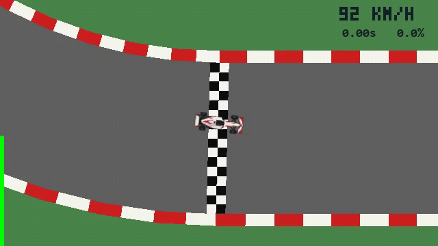

Vectorized C racing environment with a Python API and PPO trainer.

## Install and build

Requires Python 3.12+, uv, and `cl` configured for x64 builds.

```sh
uv sync
uv run python build.py
```

## Usage

```sh
uv run python ppo.py --circuit club --no-track
uv run python render.py --circuit club --play
uv run python render.py --circuit club --checkpoint build/policy-club.pt
```

Training logs to W&B unless `--no-track` is supplied. Use `--help` for options.

## Python API

```python
from racing import RacingConfig, RacingEnv

config = RacingConfig.from_track(
    "club",
    lookahead_distances=(0, 5, 10, 20, 40, 80, 150),
    samples_per_span=1,
    step_dt=0.05,
    max_steps=1200,
)
env = RacingEnv(config, num_envs=1024)
try:
    observations = env.reset()
    env.actions[:] = (0.0, 0.5)
    observations, rewards, terminated, truncated, info = env.step()
finally:
    env.close()
```

Actions are `[steering, pedal]` in `[-1, 1]`; positive pedal accelerates and negative pedal brakes. Observations contain car-relative road edges at each lookahead distance, followed by normalized forward speed, lateral speed, yaw rate, and steering angle. Reward is signed progress in laps. Cars reset automatically after a crash (`terminated`) or timeout (`truncated`); lap completion continues driving.

`info` contains `final_observations` (valid on timeout), `final_progress` (valid on reset), `lap_events`, and `lap_times` (valid on lap events). Returned arrays and the info dictionary are reused without copying; copy anything you need to retain. Tracks are JSON files in `tracks/` with `points` and `road_width`.

